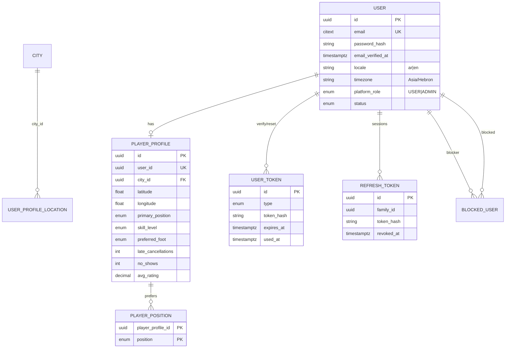
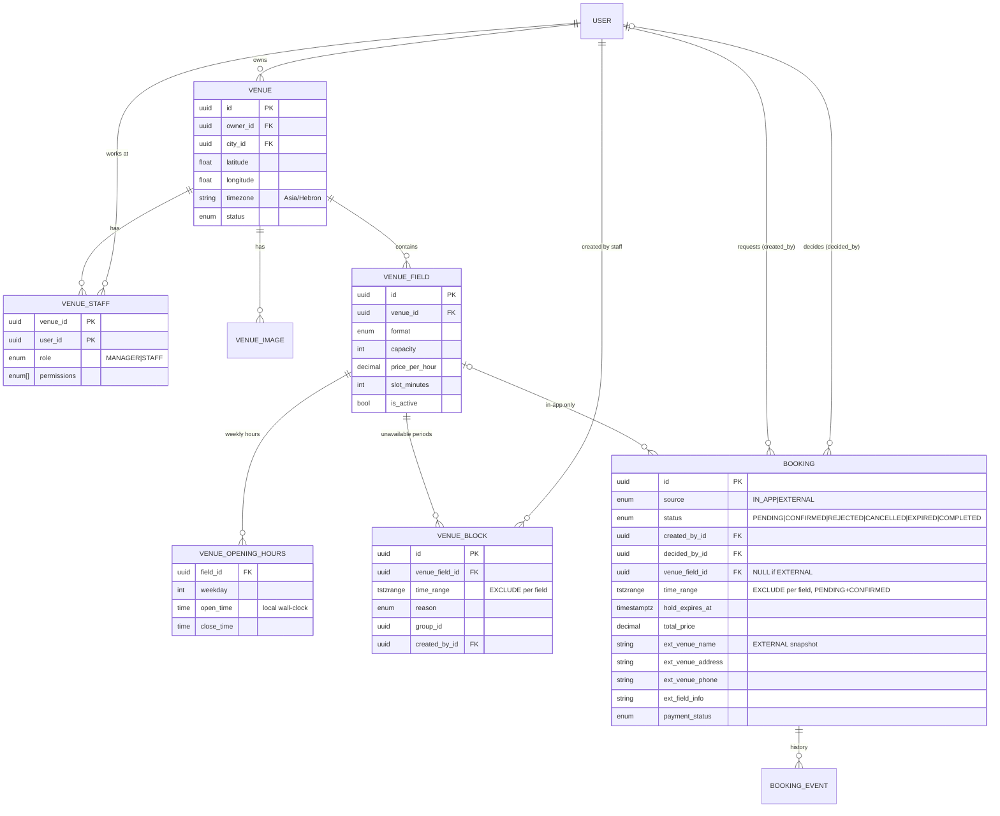
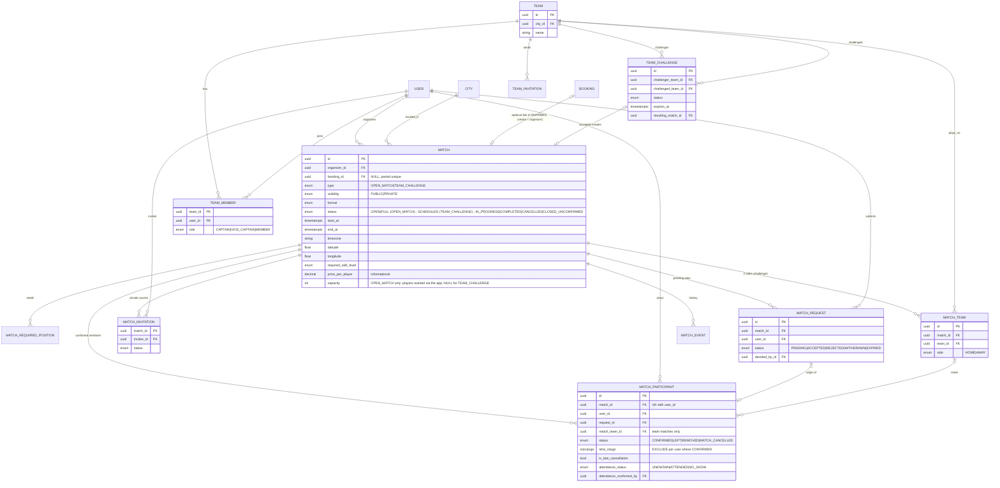
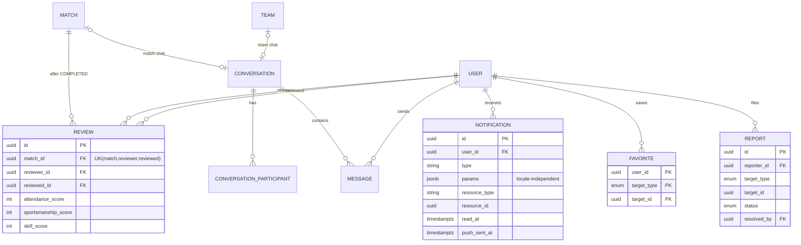

# Find Your Match — ERD (draft v0.3)

Companion to `DATABASE_DESIGN.md` (constraints, indexes, concurrency rules live there). Mermaid renders in GitHub/VS Code. Columns shown are the structurally important ones only. Status: draft — only Q-B (match rescheduling policy) is open and it does not change any table.

## 1. Identity and Players

(`USER_PROFILE_LOCATION` above stands for PlayerProfile/Venue/Match/Team each referencing `CITY`.)

## 2. Venues, Availability, Blocks, Bookings (D1, D2, D11)

Cross-table rule: BOOKING and VENUE_BLOCK never overlap on the same field (field-row lock + constraint trigger; see DATABASE_DESIGN.md §3 Booking).

## 3. Matches, Requests vs Participants, Teams (D3–D8)

`MATCH_REQUEST` (pending) and `MATCH_PARTICIPANT` (confirmed) are deliberately separate tables; only `MATCH_PARTICIPANT` rows with status CONFIRMED count. `confirmed_count` and `available_spots` are **derived** (view `match_availability`), never stored. A team's captain is the `TEAM_MEMBER` row with role CAPTAIN (one per team, partial unique index) — there is no `captain_id` column to drift.

## 4. Platform: Reviews, Notifications, Favorites, Reports, Chat

`FAVORITE`/`REPORT` targets are polymorphic (type + id); integrity is enforced in the service layer, not by FKs. Acceptable for MVP; revisit if reporting volume grows.

## 5. Cascade policy (summary)
- Default `RESTRICT`; users are anonymized (status DELETED), never hard-deleted.
- `CASCADE` only for pure children: PlayerPosition, VenueImage, VenueOpeningHours, UserToken, RefreshToken, ConversationParticipant.
- Venue/Field with any Booking or Match history: deactivate (`is_active`/status), never delete.
- `Match.booking_id`: `SET NULL` is **not** used; the link is kept so history shows the booking's final status.
